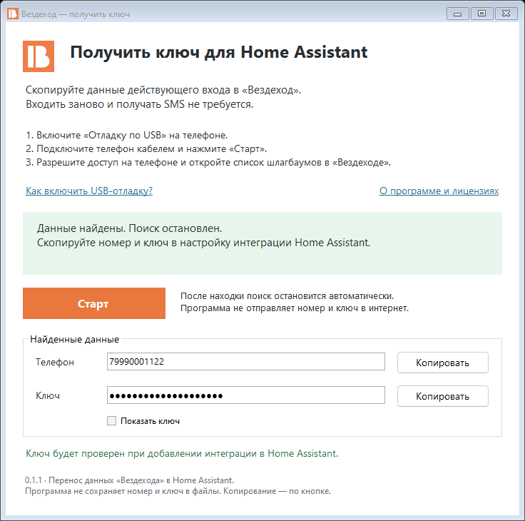

# Вездеход Key Helper 0.1.2

Программа для **Windows 10/11, 64 бит**, которая получает номер и текущий ключ
из журнала официального «Вездехода» на подключённом **Android-телефоне**.
Пользователю не нужны Python, отдельная установка ADB, root или новый APK.

[Скачать опубликованный EXE 0.1.1](https://github.com/mryasov-als/ha-vezdehod/releases/download/v0.4.3/vezdehod-key-helper.exe)
· [Пошаговая инструкция](../../docs/credentials.md#android-перенести-текущий-ключ-через-windows).

Нажмите **«Старт»**, разрешите USB-отладку с ПК и откройте список шлагбаумов
в «Вездеходе». После обнаружения номер и ключ доступны с кнопками копирования;
поиск остановится автоматически. **«Стоп»** позволяет отменить его раньше.

Программа читает журнал приложения, а не расшифровывает HTTPS. Если другая
версия «Вездехода» не пишет запросы в журнал, поиск не найдёт данные.
Пользователь подтвердил работу опубликованной версии 0.1.1 на физическом
Android-телефоне 6 ноября 2026 года.

12 ноября 2026 года пользователь подтвердил работу локального EXE версии 0.1.2
с SHA-256 `c8e3fbf1591798ffcdfefd068e8c9ecf5802daec67591288fab57b66fec11ac4`.

Номер и ключ находятся только в памяти программы. Полные журналы не
сохраняются, данные доступа не отправляются в интернет, копирование в буфер
обмена выполняется только по кнопке. Проверку ключа выполняет HA при импорте.
Программа не отправляет SMS, не открывает шлагбаум и не очищает журнал.

При сборке из этих исходников помощник запускает собственный ADB-сервер
на временном порту, доступном только с этого компьютера. Настройки адреса
общего ADB на выбор сервера не влияют. Помощник завершает свой сервер по
окончании поиска, по кнопке «Стоп» и при закрытии окна. Если другая
программа уже использует USB-подключение телефона через ADB, она может
занимать его до окончания своей работы.

## Сборка из исходников

Разработчику требуются Windows, Python 3, штатный C#-компилятор .NET Framework
и официальный Android SDK Platform Tools. Из каталога `tools/key-helper`:

```powershell
python build.py --adb-dir 'C:\Android\platform-tools'
```

Или `python build.py`, если Platform Tools установлены в стандартном
пользовательском каталоге Android SDK. Поддерживается комплект ADB 37.0.0
с `libwinpthread-1.dll`; полный NOTICE берётся из указанного комплекта.

Сборка проверяет парсер, цикл поиска, остановку дочерних процессов и выбор
ADB-сервера на тестовых данных. Затем EXE проверяет извлечение ADB командой
`adb version` и создаёт `preview.png` с вымышленными данными. Сборка не читает телефон.

Результат — `dist/vezdehod-key-helper.exe`. После успешной сборки в `build-info.json`
записываются версия, размер, SHA-256 и результаты проверок из этого запуска,
в том числе вывод `CoreTests.exe` и `InfrastructureTests.exe`.
ADB и DLL сжаты внутрь EXE; при запуске
извлекаются в `%LOCALAPPDATA%/VezdehodKeyHelper/adb-<hash>/` с проверкой хешей.
PATH и системные каталоги не меняются.

Готовый EXE не подписан цифровой подписью. Полные лицензии ADB:
[`THIRD_PARTY_NOTICES.txt`](THIRD_PARTY_NOTICES.txt), также внутри окна программы.


